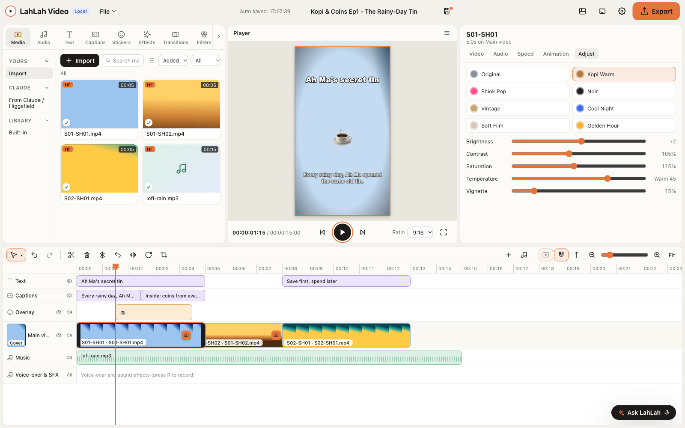
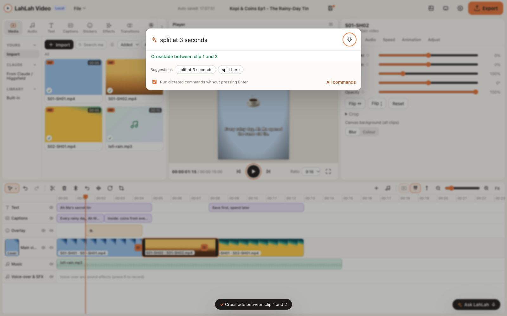
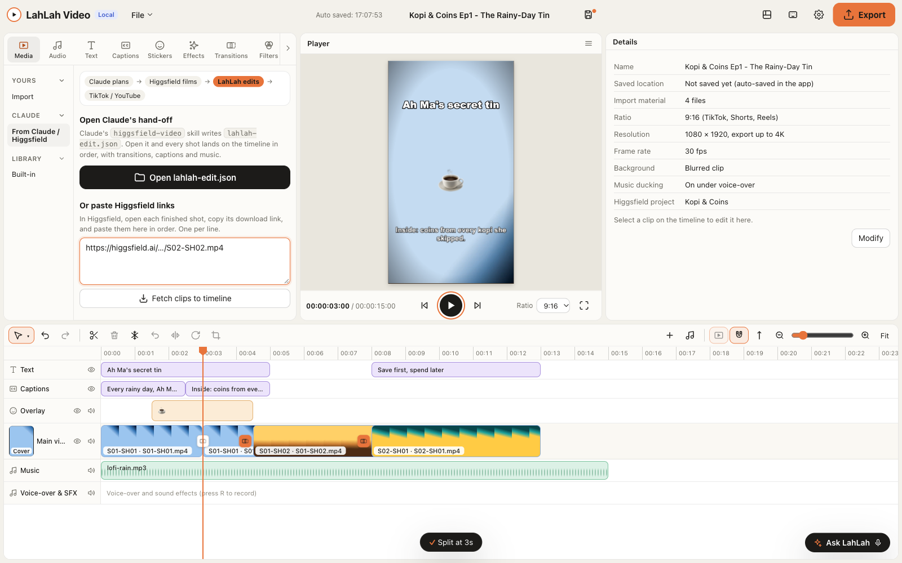

<div align="center">


# LahLah Video

**Your Higgsfield clips, cut into a TikTok in ten minutes. Say "split here" and it splits.**

A free, CapCut-style video editor for Mac and Windows, from the makers of [LahLah Voice](https://github.com/alfredang/lahlahvoiceapp). Built for the WSQ course *Agentic AI for Video Creation* by Tertiary Infotech Academy. Claude can drive it too.

[](https://github.com/alfredang/LahLahVideo/releases/latest)
[](https://github.com/alfredang/LahLahVideo/actions/workflows/ci.yml)

[](LICENSE)

</div>



If you have used CapCut you already know the layout: **Media and effects** top left, the **Player** in the middle, **Details** for the selected clip on the right, the **timeline** along the bottom, and one orange **Export** button. Everything runs on your computer.

## Where LahLah Video fits

```
 Claude plans  ──▶  Higgsfield films  ──▶  LahLah Video edits  ──▶  TikTok / YouTube
 story, storyboard,   each shot, through     trim, transitions,       upload the MP4
 script               its MCP connector      captions, music, export
```

Claude writes the story and the shot list. Higgsfield renders the shots. Claude's `higgsfield-video` skill then writes one small file, `lahlah-edit.json`. Open it in LahLah Video and every shot lands on the timeline in order, with its transition, on-screen text, subtitles and music, on a 9:16 or 16:9 canvas. You polish, press **Export for TikTok**, and upload.

Prefer CapCut? One button hands the trimmed clips and a captions file to CapCut instead.

## 1-minute install

**Mac** (Apple silicon or Intel). Open **Terminal** and paste:

```bash
curl -fsSL https://raw.githubusercontent.com/alfredang/LahLahVideo/main/install/install.sh | bash
```

**Windows 10 or 11.** Open **PowerShell** (Start menu, type *PowerShell*) and paste:

```powershell
irm https://raw.githubusercontent.com/alfredang/LahLahVideo/main/install/install.ps1 | iex
```

Each script fetches the newest release for your computer (falling back to GitHub's API link, a fixed-name copy, and `gh release download` if GitHub is having a bad day), installs it, clears the "unknown developer" block and opens the app. No admin password on Windows. On a Mac it installs to `/Applications` (or `~/Applications` if you can't write there).

Add `--with-claude` (Mac: `… | bash -s -- --with-claude`; Windows: `$env:LAHLAH_WITH_CLAUDE='1'` first) and the script also connects Claude: it opens the LahLah Video extension in Claude Desktop and registers the MCP server with Claude Code if you have it.

Want to check first? `curl -fsSL https://raw.githubusercontent.com/alfredang/LahLahVideo/main/install/install.sh | bash -s -- --dry-run` prints the exact download without installing anything. On Windows: `$env:LAHLAH_DRY_RUN='1'` before the `irm` line.

### Install with Claude

Already have Claude Code, or Claude Desktop with code execution? Paste this prompt and let Claude do it:

```text
Install LahLah Video on this computer. Detect whether I am on macOS or Windows. On macOS run: curl -fsSL https://raw.githubusercontent.com/alfredang/LahLahVideo/main/install/install.sh | bash . On Windows run in PowerShell: irm https://raw.githubusercontent.com/alfredang/LahLahVideo/main/install/install.ps1 | iex . Show me each command before you run it, then confirm that LahLah Video opens.
```

Claude checks your OS, shows you the one command, runs it, and confirms the LahLah Video window is up.

### Manual install

1. Open the [latest release](https://github.com/alfredang/LahLahVideo/releases/latest) and download one file:
   - `…_aarch64.dmg` for Macs with Apple silicon (M1 to M4 and later)
   - `…_x64.dmg` for Intel Macs
   - `…_x64-setup.exe` for Windows
2. **Mac:** open the `.dmg`, drag **LahLah Video** into **Applications**. The first launch shows *"Apple could not verify LahLah Video"*. Click **Done**, open **System Settings → Privacy & Security**, scroll down and click **Open Anyway**. (Or run `xattr -dr com.apple.quarantine "/Applications/LahLah Video.app"` in Terminal.)
3. **Windows:** run the `.exe`. If *"Windows protected your PC"* appears, click **More info → Run anyway**.

The app is not yet signed with paid Apple and Microsoft certificates, so both systems ask once. The install scripts skip that step for you.

## What you can do

| | |
|---|---|
| **Bring clips in** | Drag and drop videos, photos and music, or click Import; the round **+** on a card drops it at the playhead. Paste Higgsfield download links to pull shots straight onto the timeline. Open a `lahlah-edit.json` hand-off from Claude (**File → Open edit…**). |
| **Cut on a real timeline** | Main video track (with a Cover tile) that snaps clips end to end, overlay, text and captions tracks above, audio below. Drag to move or reorder, drag edges to trim, **S** to split, Delete and ripple delete, duplicate, freeze frame, reverse, mirror, rotate, crop, snapping, a hover preview axis, zoom, undo and redo. Right-click a clip for more. |
| **Pick the right shape** | 9:16 for TikTok, Shorts and Reels; 16:9 for YouTube; 1:1; 4:5. Fill the empty space with a blurred copy of the clip or a solid colour. |
| **Move and style each clip** | Drag it on the preview. Position, size, rotate, flip, crop, opacity, speed from 0.25× to 4×, volume, mute, fade in and out, and keyframes for position, size and opacity (plus one-click Ken Burns zoom, Pop in, Slide up). |
| **Join shots** | Cut, crossfade, slide, zoom, wipe and dip to black, between any two clips or across the whole video in one click. |
| **Colour** | Brightness, contrast, saturation, temperature and vignette, plus eight looks: Kopi Warm, Shiok Pop, Noir, Vintage, Cool Night, Soft Film, Golden Hour and Original. |
| **Words on screen** | Eight text styles (TikTok bold, Yellow pop, Neon night, Lower third…), a captions track you can edit line by line, SRT import and export, and optional auto-captions with your own OpenAI key. |
| **Sound** | Background music, sound effects, voice-over recorded from your mic while the video plays, and music that ducks under your voice on export. |
| **Stickers** | 24 emoji stickers, from 🔥 to 🇸🇬. |
| **Export** | MP4 (H.264 + AAC) at 720p, 1080p or 4K and 24, 30 or 60 fps, with TikTok, YouTube Shorts and YouTube 16:9 presets and a progress bar. Files land in `Movies/LahLah Video` (Mac) or `Videos\LahLah Video` (Windows) unless you pick another folder. |
| **Projects** | Save and open `.lahlah` files, automatic save while you work, and recent projects on the start screen. |
| **Effects and templates** | Motion effects (slow zoom, zoom out, pop in, slide up, drift, fades) and starter templates for TikTok, YouTube and square posts. |
| **Try it first** | **Templates › Kopi & Coins demo** builds a 12-second *Kopi & Coins* edit with transitions, text, captions, a sticker and music, so you can practise before your own clips arrive. |

## Use LahLah Video from Claude

LahLah Video ships an MCP server, so Claude can open your hand-off, make edits, look at a frame and export, while you watch the timeline change. Every edit goes into the undo history.

**Claude Desktop (one click):** download [`lahlah-video.mcpb`](https://github.com/alfredang/LahLahVideo/releases/latest/download/lahlah-video.mcpb) and double-click it. Claude Desktop shows the LahLah Video extension; click **Install**. (Settings › Extensions lists it afterwards.)

**Claude Code:**

```bash
claude mcp add lahlah-video -- npx -y https://github.com/alfredang/LahLahVideo/releases/latest/download/lahlah-video-mcp.tgz
```

**Any MCP client** (`claude_desktop_config.json` or similar, Node.js 18+):

```json
{
  "mcpServers": {
    "lahlah-video": {
      "command": "npx",
      "args": ["-y", "https://github.com/alfredang/LahLahVideo/releases/latest/download/lahlah-video-mcp.tgz"]
    }
  }
}
```

The server finds the running app through `control.json` and starts LahLah Video if it is closed. Turn access off any time in **Settings › API**.

| Tool | What Claude can do |
|---|---|
| `status` | See the app version, open project, duration, canvas and recent exports |
| `open_handoff` | Open `lahlah-edit.json` (path or inline JSON): every Higgsfield shot lands in order |
| `add_clips` | Download Higgsfield result URLs or import files onto a track |
| `run_command` | Any command-bar edit: "add crossfade", "split at 3 seconds", "undo" |
| `get_timeline` | Read tracks, clips, captions and timings as JSON |
| `set_captions` | Replace the captions from SRT text or a list |
| `export` / `export_status` | Export for TikTok, YouTube Shorts or YouTube and follow progress |
| `list_projects` / `save_project` | See recent projects and save the open one |
| `snapshot` | Get a PNG of any frame, rendered exactly as the export will look |

**What a session looks like:**

> **You:** Turn today's Kopi & Coins shots into a TikTok.
>
> **Claude** (higgsfield-video skill): renders the shots in Higgsfield and writes `~/Kopi/ep1/lahlah-edit.json`, then calls `lahlah-video.open_handoff` with that path. *"Laid out 6 shots, 31.5 s, 9:16, with captions and the lo-fi track."*
>
> **You:** The cut into the tin feels abrupt.
>
> **Claude:** `run_command("go to 9 seconds")`, `run_command("add crossfade")`, then `snapshot(t: 9.3)` to check the frame. *"Crossfade added between shots 2 and 3; the caption still reads clearly."*
>
> **You:** Ship it.
>
> **Claude:** `export(preset: "tiktok")` returns job `exp_…`; `export_status` until `done`. *"Saved to Movies/LahLah Video/Kopi & Coins Ep1.mp4 (1080 × 1920)."*

### The local API

Scripts (and LahLah Voice) can use the same API directly: HTTP on `127.0.0.1` with the key from **Settings › API** (show, copy, regenerate, on/off). See [docs/API.md](docs/API.md) for the endpoints and examples, or fetch `/openapi.json` from the running app.

## Talk to it

Press **Cmd+K** (Mac) or **Ctrl+K** (Windows), or click **Ask LahLah** at the bottom right of the timeline. Type, or dictate:

- **Mac:** [LahLah Voice](https://github.com/alfredang/lahlahvoiceapp) types straight into the box. With *LahLah Video commands* on in LahLah Voice you can skip the box: say *"Video, split here"* from anywhere and LahLah Voice sends it through this app's API (or its `lahlahvideo://` link).
- **Windows:** click in the box and press **Win+H**.

Commands run offline with a built-in parser: no account, no API key. Numbers can be words ("split at three seconds").





| Play and move | Cut and trim | Speed and sound |
|---|---|---|
| `play` · `pause` | `split here` · `split at 3 seconds` | `speed up 2x` · `slow down` |
| `go to 10 seconds` · `go to the start` | `delete clip` · `ripple delete` | `half speed` · `normal speed` |
| `skip forward 5 seconds` | `duplicate` | `mute` · `unmute` · `volume 50%` |
| `next clip` · `previous clip` | `trim start to 1.5 seconds` · `trim end to 4 seconds` | `add music` · `record voice-over` |
| | `cut the first 2 seconds` | |

| Look and feel | Text and stickers | Canvas, files, export |
|---|---|---|
| `add crossfade` · `add slide transition` | `add text 'Save first' at 2 seconds` | `make it vertical` · `make it 9:16` |
| `dip to black` · `fade in` · `fade out` | `add title "Kopi & Coins" for 3 seconds` | `make it YouTube` · `make it square` |
| `add filter kopi warm` · `make it black and white` | `add sticker fire` | `zoom in` · `undo` · `redo` · `save project` |
| `make it bigger` · `rotate 90 degrees` · `flip` | `auto captions` | `export for TikTok` · `export for TikTok now` · `export for YouTube in 4K` |

Type `help` in the command bar for this list inside the app.

**Links other apps can open.** `lahlahvideo://command?text=split%20here` runs a command. `lahlahvideo://open?file=/path/to/lahlah-edit.json` opens a project or hand-off file.

### Keyboard

| Key | Does |
|---|---|
| Space | Play / pause |
| S | Split at the playhead |
| Delete / Shift+Delete | Delete / ripple delete |
| Cmd/Ctrl+D | Duplicate |
| Cmd/Ctrl+Z, Cmd/Ctrl+Shift+Z | Undo, redo |
| ← → (Shift: 1 s) | Step one frame |
| Home / End | Start / end |
| + / − | Zoom the timeline |
| R | Record voice-over |
| Cmd/Ctrl+K, S, O, E | Command bar, save, open, export |

## The hand-off file: `lahlah-edit.json`

Claude's `higgsfield-video` skill writes this after Higgsfield renders the shots. LahLah Video reads it with **File → Open edit…**, **Media › From Claude / Higgsfield › Open lahlah-edit.json**, a drag onto the window, `lahlahvideo://open?file=…`, or the MCP tool `open_handoff`. Only `schema` and `clips[].src` are required; everything else is optional.

```json
{
  "schema": "lahlah-edit/1",
  "title": "Kopi & Coins Ep1 - The Rainy-Day Tin",
  "platform": "tiktok | youtube | youtube-shorts | reels | microdrama",
  "aspect": "9:16", "fps": 30,
  "higgsfield_project": {"name": "Kopi & Coins", "url": "https://higgsfield.ai/..."},
  "clips": [{"id": "S01-SH01", "scene": 1, "shot": 1, "src": "https://...mp4 or local path", "duration": 5.0,
             "trim_in": 0, "trim_out": 5.0, "transition_in": "cut|crossfade|slide|zoom|wipe|dip", "caption": "optional on-screen text", "voiceover": "optional VO line"}],
  "audio": [{"src": "...", "start": 0, "volume": 0.6, "type": "music|vo|sfx"}],
  "captions": [{"start": 0.0, "end": 2.5, "text": "..."}]
}
```

How LahLah reads it:

- **Clips** go on the main track in array order. `trim_in`/`trim_out` (seconds into the source) win over `duration`. `transition_in` joins a clip to the one before it (0.5 s).
- **`src`** can be a `https://` link (downloaded next to the JSON in `higgsfield-downloads/`) or a file path, absolute or relative to the JSON file.
- **`caption`** becomes on-screen text over that clip. **`captions`** fills the Captions track; if it is missing, each clip's **`voiceover`** line becomes its subtitle.
- **`aspect`** sets the canvas; without it, `youtube` means 16:9 and every other platform 9:16.
- **`audio`**: `music` goes on the Music track (and ducks under `vo`), `vo` and `sfx` on the Voice-over & SFX track.

A full example lives in [`examples/lahlah-edit.example.json`](examples/lahlah-edit.example.json).

## Run it from source

You need [Node.js 20+](https://nodejs.org). For the desktop app you also need [Rust](https://rustup.rs) and the [Tauri prerequisites](https://v2.tauri.app/start/prerequisites/).

```bash
git clone https://github.com/alfredang/LahLahVideo.git
cd LahLahVideo
npm install
npm run desktop      # downloads FFmpeg for your machine once, then runs `tauri dev`
```

**Browser-only preview** (no Rust): `npm run dev` and open http://localhost:1420. Editing, preview, voice commands and the demo all work; Export shows a clear "needs the desktop app" message, because MP4 export uses the FFmpeg engine bundled with the app. Add `?demo=1` to the URL to open the demo project.

```bash
npm test             # command parser, timeline maths, hand-off and SRT tests
LAHLAH_FFMPEG=/path/to/ffmpeg npm test   # also renders a sample project through FFmpeg
npm run build        # web bundle
npm run tauri build  # installers for this machine
```

Pushing a `v*` tag runs [`.github/workflows/release.yml`](.github/workflows/release.yml), which builds the Apple silicon and Intel `.dmg` files and the Windows `.exe` and attaches them to a GitHub Release.

### Under the hood

| Part | Built with |
|---|---|
| Desktop shell | [Tauri 2](https://v2.tauri.app) (Rust) using the system web view, so the app stays small |
| Editor | React 19 + TypeScript + Vite, white theme from LahLah Voice's design tokens ([`src/styles/tokens.css`](src/styles/tokens.css)) |
| Claude | MCP server in [`mcp/`](mcp/) (`@modelcontextprotocol/sdk`), packed as a Claude Desktop extension (`.mcpb`); local API in [`src-tauri/src/control.rs`](src-tauri/src/control.rs) |
| Export | [FFmpeg](https://ffmpeg.org) 6 static build ([ffmpeg-static](https://github.com/eugeneware/ffmpeg-static)), bundled as a sidecar. The whole timeline becomes one `filter_complex`: `xfade` for transitions, `overlay` for layers and keyframes, `eq`/`colortemperature`/`vignette` for colour, `amix` + `sidechaincompress` for music ducking. Text and stickers are drawn once on a canvas and burned in, so the MP4 matches the preview. |
| Voice | Offline rule-based parser ([`src/commands/parse.ts`](src/commands/parse.ts)), deep links via `tauri-plugin-deep-link` |

### Topic-to-video mode

The original LahLahVideo pipeline (type a topic, Claude writes the script, Edge TTS narrates, Remotion animates) lives on in [`topic-to-video/`](topic-to-video/README.md). Render a video there, then drop the MP4 into LahLah Video to trim, caption and export it.

## Troubleshooting

| Problem | Fix |
|---|---|
| Mac: *"LahLah Video is damaged"* or *"cannot be verified"* | Run `xattr -dr com.apple.quarantine "/Applications/LahLah Video.app"`, or use System Settings → Privacy & Security → **Open Anyway**. |
| Windows: *"Windows protected your PC"* | **More info → Run anyway.** The install script avoids this. |
| Windows: the window stays blank | Install the [Microsoft Edge WebView2 runtime](https://developer.microsoft.com/microsoft-edge/webview2/) (built into Windows 11). |
| `curl: command not found` on Windows | You're in Command Prompt. Use **PowerShell** and the `irm … \| iex` line. |
| PowerShell says scripts are disabled | The `irm … \| iex` line doesn't need script permission. If your IT policy still blocks it, use the manual install. |
| Voice-over records nothing | Mac: System Settings → Privacy & Security → **Microphone** → turn on LahLah Video. Windows: Settings → Privacy → Microphone. |
| A Higgsfield link won't download | Use the clip's direct download link (it usually ends in `.mp4`), not the page link. Links can expire; copy a fresh one. |
| Export failed | The error box shows FFmpeg's last lines. The usual cause is a clip that moved or was deleted after import; re-import it. |
| Export is slow | 4K takes several times longer than 1080p. TikTok and YouTube Shorts look sharp at 1080p. |
| `lahlahvideo://` links (from LahLah Voice or Claude) do nothing on a Mac | Another copy of the app (an old `.dmg`, a copy in Downloads) may be answering the links. Re-run the install line, which makes `/Applications/LahLah Video.app` the owner, or run `/System/Library/Frameworks/CoreServices.framework/Frameworks/LaunchServices.framework/Support/lsregister -f "/Applications/LahLah Video.app"`. |
| Claude says LahLah Video is not running | Open LahLah Video once, and check **Settings › API › Allow API control** is on. The MCP server reads `control.json` from the app-data folder. |
| The mic button says speech isn't available | Desktop web views rarely ship a speech service. Dictate into the box with LahLah Voice (Mac) or Win+H (Windows). |

## Credits

Built by **Dr Alfred Ang** and [Tertiary Infotech Academy](https://www.tertiarycourses.com.sg) for the WSQ course *Agentic AI for Video Creation*. Uses [Tauri](https://tauri.app), [React](https://react.dev), [FFmpeg](https://ffmpeg.org) (GPL static build from ffmpeg-static, shipped as a separate program) and [Remotion](https://www.remotion.dev) (topic mode). CapCut, Higgsfield, TikTok and YouTube are trademarks of their owners; LahLah Video is not affiliated with them.
